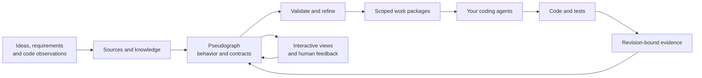

# Graph-Driven Development

**Plan software as a graph. Give agents clear contracts. Verify what they build.**

Graph-Driven Development (GDD) is a method and a draft standard for planning,
building and changing software through an agent-readable pseudograph. The graph
connects intent, components, behavior, data, screens, dependencies and evidence.
An action can contain pseudocode and a precise contract without choosing a
programming language.

GDD gives humans and coding agents a shared description of how a system should
work. Agents refine that description, use it to scope development, and show the
result through interactive views. The implementation language and agent runtime
remain project choices.

**Current status:** GDD 0.3 draft · CLI/package 0.6.0 · Python 3.11+.
The validator, graph viewer, Graphify adapter and development workflow work today.
Project scaffolding and an installable GDD skill are the next onboarding work in
[the repository readiness plan](REPOSITORY-PLAN.md).

## How the method works



Start with an idea, requirements or an existing codebase. An agent records the
sources, makes uncertainty explicit, and iterates the graph. Each implementation
scope needs enough detail to act on: public contracts, component boundaries,
behavior, relevant risks and scenarios. Independent work can then proceed in
parallel against shared contracts. Integration and actual checks establish what
was built; new requirements start another graph iteration.

Every component boundary has a short reason for existing. Public contracts make
cross-component calls explicit. KISS, DRY, separation of concerns and modularity
are review topics; precise rules can become blocking checks when a trusted
checker can verify the actual implementation.

## Try the CLI

This source-checkout quickstart requires Python 3.11+ and
[uv](https://docs.astral.sh/uv/). It needs no LLM credentials, Graphify installation
or frontend build. The generated graph works offline. These commands use a POSIX shell.

```sh
git clone https://github.com/mikkelkrogsholm/gdd.git
cd gdd
uv sync --locked
uv run gdd --help

# Check structural readiness of a backend scope in the supplied 0.3 model.
uv run gdd validate examples/concert-0.3.gdd.yaml --profile readiness --scope action.reserve

# Use a fresh directory: generated artifacts never overwrite existing files.
GDD_QUICKSTART_DIR="$(mktemp -d)"
uv run gdd snapshot examples/concert-0.3.gdd.yaml --output "$GDD_QUICKSTART_DIR/snapshot.json"
uv run gdd context examples/concert-0.3.gdd.yaml --scope action.reserve --output "$GDD_QUICKSTART_DIR/context.json"
uv run gdd view examples/concert-0.3.gdd.yaml --output "$GDD_QUICKSTART_DIR/graph.html"
uv run gdd validate examples/concert-0.3.gdd.yaml --profile visualization --view "$GDD_QUICKSTART_DIR/graph.html"
```

These checks should exit 0. Open `$GDD_QUICKSTART_DIR/graph.html` in a browser.
Explore communities, search nodes, follow relationships and inspect contracts and
pseudocode. The full example also contains a frontend sketch; passing readiness
for `action.reserve` applies to that backend scope.

The model's sources and normative assets determine its snapshot identity. Context
is a reading boundary; write ownership is declared separately in a development
plan. See [CLI usage and trust boundaries](VALIDATOR.md).

## Use GDD with an agent

Today, give your coding agent [GDD.md](GDD.md), the standard, and your project's
mandate. The [lead](agents/gdd-lead.md) and [worker](agents/gdd-worker.md) guides
explain graph iteration, work packages, integration and verification.

A starting prompt:

```text
Use Graph-Driven Development to plan this project: <idea or repository>.
Read GDD.md and follow the GDD 0.3 standard.
Capture the sources and open questions, then propose a pseudograph with
component responsibilities, boundary rationales, public contracts and scenarios.
Generate a view so I can inspect the plan. Identify the next implementable scope
and assess its readiness. Follow this project's working mode and mandate.
```

The CLI derives context and checks plans; your existing agent runtime performs
reasoning, edits, transport and actual test execution. A dispatch record does not
start an agent. The planned installable skill will package this workflow into one
reusable entry point; it is not present yet.

| Starting point | Path through GDD |
| --- | --- |
| A new idea | Register sources, author a sketch, resolve questions, refine a bounded scope, validate it and prepare work |
| An existing codebase | Import supported Graphify observations, preserve provenance, propose intended behavior explicitly, then refine and validate |
| A requirement change | Revise the relevant contracts and scenarios, preserve the previous snapshot, prepare a current plan and verify changed code |

Knowledge can come from documents or a maintained wiki/OKF bundle. UI scopes can
reference DESIGN.md. These are optional integrations chosen to fit the project;
missing required design or contract information stays explicit.

## What the tools support

| Capability | Current behavior |
| --- | --- |
| Model and scoped readiness | Validate GDD 0.3 and preserved 0.2 contracts, references, boundaries, contracts, risks and scenarios |
| Graph exploration | Generate and verify a standalone interactive HTML view with search, communities and inspectors |
| Agent context and public boundaries | Extract revision-bound context and derived component/community interfaces |
| Development workflow | Prepare work packages and journal dispatch, submission, integration, cancellation and acceptance |
| Existing-code observations | Lossless Graphify import/export and explicit unaccepted intent proposals for the documented profiles |
| Design review | Check a revision-bound advisory review's structure and applicability |
| Evidence | Assess immutable check plans, bindings and host-verified execution claims against current revisions |

Read [workflow](WORKFLOW.md), [viewer](VIEWER.md), [Graphify integration](GRAPHIFY.md)
and [design principles](standard/DESIGN-PRINCIPLES.md) for each capability's exact
contract. Graphify support is profile-specific; unsupported or ambiguous input
remains UNKNOWN.

GDD reports four separate assessments: **model validity, structural readiness,
authorization and implementation evidence**. A valid graph does not establish
that its code behaves correctly. Tests, real-source architecture checks and
human/agent review supply that evidence. The CLI executes no pseudocode, model
check labels or LLM calls, and broad design principles have no automatic quality
guarantee.

CLI reports are machine-readable JSON. Exit **0** means requested checks passed,
**1** means a known failure or denial, and **2** means unresolved information
without a known failure. With `--activity`, the records profile assesses
authorization; ordinary records validation assesses implementation evidence.

## An executed reference experiment

The [concert reservation experiment](examples/concert-app/README.md) used actual
native agent work packages to build a local browser/SQLite app. A revised graph
introduced a global reservation limit: ten fixed requirement tests first produced
eight failures against the old code, then all ten passed the new implementation.
The same database retained its history. A deliberately forbidden API-to-storage
import was detected; repair passed, and missing source remained UNKNOWN.

The final local run passed 112 application/checker tests and eight browser cases.
A fresh replay reproduced both delivered code snapshots and accepted new workflow
runs. Independent review also found and helped repair real defects; the preserved
history records those limitations. See [results and provenance](examples/concert-app/evidence/README.md).

This is evidence from a bounded example. Independent onboarding and use on other
projects are part of [the readiness goal](REPOSITORY-PLAN.md).

## Read, contribute and extend

| You want to… | Start here |
| --- | --- |
| Apply the method as an agent | [GDD.md](GDD.md) |
| Understand the standard and format | [SPEC.md](SPEC.md) and [FORMAT.md](standard/FORMAT.md) |
| Use or extend the tools | [VALIDATOR.md](VALIDATOR.md), [WORKFLOW.md](WORKFLOW.md), [schemas](schemas/README.md) |
| Understand validation and authority | [VALIDATION.md](standard/VALIDATION.md) |
| Explore examples | [examples](examples/README.md) |
| Understand integrations and decisions | [INTEGRATIONS.md](standard/INTEGRATIONS.md), [DECISIONS.md](standard/DECISIONS.md) |
| Follow repository readiness work | [REPOSITORY-PLAN.md](REPOSITORY-PLAN.md) |

For development and conformance checks:

```sh
uv sync --locked --group dev
uv run pytest -q
uv run python conformance/run.py
uv run python conformance/run_graphify.py
uv run python conformance/run_visualization.py
uv run python conformance/run_workflow.py
uv run python conformance/run_design.py
```

Follow [repository instructions](AGENTS.md) when changing normative assets,
revisions or generated artifacts. Repository prose is English. GDD 0.2 has an
explicit [historical contract](archive/gdd-0.2/README.md); other previous material
and execution claims are preserved in [archive](archive/) and [evidence](evidence/README.md).
