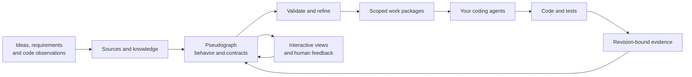

# Graph-Driven Development

**Plan software as a graph. Give agents clear contracts. Verify what they build.**

Graph-Driven Development (GDD) is a method and a draft standard for planning,
building and changing software through an agent-readable pseudograph. The graph
connects intent, components, behavior, data, screens, dependencies and evidence.
An action can contain pseudocode and a precise contract without choosing a
programming language.

GDD gives humans and coding agents a shared description of how a system should
work. Agents refine that description, use it to scope development, and show the
result through interactive views. The implementation language and agent runtime
remain project choices.

**Current development status:** GDD 0.3 draft · CLI/package 0.8.0 (unreleased) · viewer 0.3.0 · Python 3.11+ ·
[MIT licensed](LICENSE). The repo includes the method, deterministic CLI, offline
viewer, Graphify adapter, safe project starter and a portable agent skill.
The viewer includes Cytoscape.js and fCoSE; [third-party notices](gdd_validator/viewer/vendor/THIRD-PARTY-NOTICES.txt) accompany the MIT-licensed GDD code.
The first development release is [v0.7.0](https://github.com/mikkelkrogsholm/gdd/releases/tag/v0.7.0).
Install from tagged source or its verified wheel; the package is not on PyPI.

## How the method works



Start with an idea, requirements or an existing codebase. An agent records the
sources, makes uncertainty explicit, and iterates the graph. Each implementation
scope needs enough detail to act on: public contracts, component boundaries,
behavior, relevant risks and scenarios. Independent work can then proceed in
parallel against shared contracts. Integration and actual checks establish what
was built; new requirements start another graph iteration.

Every component boundary has a short reason for existing. Public contracts make
cross-component calls explicit. KISS, DRY, separation of concerns and modularity
are review topics; precise rules can become blocking checks when a trusted
checker can verify the actual implementation.

## Start with the tutorial

[Build a small Python implementation from a GDD graph](docs/tutorial.md).
Start with a sketch, refine a contract, inspect the graph, implement and test it,
then capture revision-bound evidence with the host helpers. A deliberately broken
implementation shows why a check must detect failure before its PASS is trusted.
The tutorial uses the development checkout and needs no LLM account.

For the method without commands, read [GDD.md](GDD.md). For installation choices,
see [INSTALL.md](INSTALL.md).

### Try the released CLI

This source-checkout quickstart requires Python 3.11+ and
[uv](https://docs.astral.sh/uv/). It needs no LLM credentials, Graphify installation
or frontend build. The generated graph works offline. These commands use a POSIX shell.
The quickstart uses the published release; use `main` instead of `v0.7.0` to try
the latest development changes, including the Cytoscape.js/fCoSE viewer and
community areas.

```sh
git clone https://github.com/mikkelkrogsholm/gdd.git
cd gdd
git checkout v0.7.0
uv sync --locked
uv run gdd --help

# Create a new project inside a fresh location.
GDD_QUICKSTART_DIR="$(mktemp -d)"
uv run gdd init "$GDD_QUICKSTART_DIR/project" --project-id project.my-app --title "My app"
uv run gdd validate "$GDD_QUICKSTART_DIR/project/gdd.json"
uv run gdd view "$GDD_QUICKSTART_DIR/project/gdd.json" --output "$GDD_QUICKSTART_DIR/graph.html"
uv run gdd validate "$GDD_QUICKSTART_DIR/project/gdd.json" --profile visualization --view "$GDD_QUICKSTART_DIR/graph.html"

# Expected exit 1: a new draft needs requirements and contracts before coding.
uv run gdd validate "$GDD_QUICKSTART_DIR/project/gdd.json" --profile readiness --scope action.main
```

Initialization creates `gdd.json`, `SOURCES.md` and an empty `records.json`.
It refuses existing directories. The model and view checks exit 0; the final
readiness check exits 1 for the explicit open scope question. The starter supplies
no accepted requirements, authority or PASS execution evidence.

Open `$GDD_QUICKSTART_DIR/graph.html` in a browser. To explore a richer graph,
generate a view of `examples/concert-0.3.gdd.yaml` in another fresh output file.
It contains communities, contracts and pseudocode; its `action.reserve` backend
scope passes structural readiness while its frontend remains a sketch.

See [CLI reference](VALIDATOR.md) for commands, revision identities and work-package boundaries.

## Use GDD with an agent

Copy the whole [GDD skill](skills/gdd/SKILL.md) into your agent runtime's supported
skill location, or point an agent at its `SKILL.md`. The folder contains its own
guidance and schemas and also ships in the wheel. Follow the
[installation instructions](INSTALL.md#install-the-standalone-agent-skill);
the CLI must be installed separately. Give the agent your brief, project location
and mandate.

Installed-skill journeys have been verified with native Codex. Other runtime
journeys remain unverified; see [runtime trials](docs/runtime-trials.md) for scope
and setup.

A starting prompt:

```text
Use Graph-Driven Development to plan this project: <idea or repository>.
Use the installed GDD skill and follow the GDD 0.3 standard.
Capture the sources and open questions, then propose a pseudograph with
component responsibilities, boundary rationales, public contracts and scenarios.
Generate a view so I can inspect the plan. Identify the next implementable scope
and assess its readiness. Follow this project's working mode and mandate.
```

The skill guides source capture, questions, graph refinement, bounded development
and verification. The CLI derives context and checks plans; your existing agent
runtime performs reasoning, edits, transport and actual test execution. A dispatch
record does not start an agent. The [portable host API](HOST.md) helps that trusted
runtime capture actual code revisions and check receipts without project-specific
evidence plumbing. The [lead](agents/gdd-lead.md) and [worker](agents/gdd-worker.md)
guides describe coordination when parallel work is useful.

| Starting point | Path through GDD |
| --- | --- |
| A new idea | Register sources, author a sketch, resolve questions, refine a bounded scope, validate it and prepare work |
| An existing codebase | Import supported Graphify observations, preserve provenance, propose intended behavior explicitly, then refine and validate |
| A requirement change | Revise the relevant contracts and scenarios, preserve the previous snapshot, prepare a current plan and verify changed code |

Knowledge can come from documents or a maintained wiki/OKF bundle. UI scopes can
reference DESIGN.md. These are optional integrations chosen to fit the project;
missing required design or contract information stays explicit.

## What the tools support

| Capability | Current behavior |
| --- | --- |
| Project start | `gdd init` publishes a valid, explicitly unready GDD 0.3 draft without overwriting work |
| Agent skill | Self-contained new-project, existing-code and change routes with synchronized standard references |
| Model and scoped readiness | Validate GDD 0.3 and preserved 0.2 contracts, references, boundaries, contracts, risks and scenarios |
| Session overview | `gdd status` keeps existing assessments separate and summarizes diagnostic-grounded next actions, with an optional explicit workflow run |
| Change consequences | `gdd impact` explains declared potential callers/dependents with directional witnesses and separate supporting context |
| Model review | `gdd diff` compares stable IDs and exact declared fields across two models, with advisory structural weakening indicators |
| Graph exploration | Generate and verify a standalone interactive HTML view with search, communities and inspectors |
| Agent context and public boundaries | Extract revision-bound context and derived component/community interfaces |
| Development workflow | Prepare work packages and journal dispatch, submission, integration, cancellation and acceptance |
| Existing-code observations | Lossless Graphify import/export and explicit unaccepted intent proposals for the documented profiles |
| Python architecture checks | `gdd check-code` compares static source imports with explicit graph constraints using implementation-specific binding records |
| Design review | Check a revision-bound advisory review's structure and applicability |
| Evidence | Assess immutable check plans, bindings and host-verified execution claims against current revisions |
| Host helpers | Explicit Python API for actual snapshots, command execution and immutable checked evidence records |

Read [workflow](WORKFLOW.md), [viewer](VIEWER.md), [Graphify integration](GRAPHIFY.md)
and [design principles](standard/DESIGN-PRINCIPLES.md) for each capability's exact
contract. Graphify support is profile-specific; unsupported or ambiguous input
remains UNKNOWN.

GDD keeps four assessments separate:

| Assessment | What it establishes |
| --- | --- |
| Model validity | The graph follows the supported format and structural rules |
| Structural readiness | The selected scope has the declared information needed for implementation |
| Authorization | The trusted host supplies a current mandate for the requested activity |
| Implementation evidence | Applicable checks and bindings are supported by host-verified execution evidence |

The tutorial follows these distinctions through a concrete implementation.
[Validation semantics](standard/VALIDATION.md) define the assessments;
[HOST.md](HOST.md) explains actual execution and trust. The CLI does not execute
pseudocode or LLM calls. Broad design principles still need review.

Validation reports are JSON: exit **0** means requested checks passed,
**1** means a known failure or denial, and **2** means unresolved information
without a known failure. Individual tool formats are documented in the
[CLI reference](VALIDATOR.md).

## An executed reference experiment

The [concert reservation experiment](examples/concert-app/README.md) used actual
native agent work packages to build a local browser/SQLite app. A revised graph
introduced a global reservation limit: ten fixed requirement tests first produced
eight failures against the old code, then all ten passed the new implementation.
The same database retained its history. A deliberately forbidden API-to-storage
import was detected; repair passed, and missing source remained UNKNOWN.

The final local run passed 112 application/checker tests and eight browser cases.
A fresh replay reproduced both delivered code snapshots and accepted new workflow
runs. Independent review also found and helped repair real defects; the preserved
history records those limitations. See [results and provenance](examples/concert-app/evidence/README.md).

The reader-facing reference is curated; its complete original 197-file subtree
is preserved in a [byte-indexed recovery archive](archive/experiments/README.md).
See [repository readiness evidence](evidence/repository-readiness.md) for the
independent installed-skill journeys and current verification scope. These are
bounded trials, not a guarantee for every project, language or agent runtime.

## Read, contribute and extend

Contributions are welcome, including small documentation fixes, bug reports,
conformance cases, adapters and standard proposals. Start with
[CONTRIBUTING.md](CONTRIBUTING.md), open an
[issue](https://github.com/mikkelkrogsholm/gdd/issues/new/choose), or submit a
focused pull request from your fork. Version tags identify reproducible package
snapshots; [RELEASING.md](RELEASING.md) explains how they are checked and published.

| You want to… | Start here |
| --- | --- |
| Complete a first graph-to-code journey | [Tutorial](docs/tutorial.md) |
| Apply the method as an agent | [GDD.md](GDD.md) |
| Install the CLI and standalone skill | [INSTALL.md](INSTALL.md), [skills/gdd](skills/gdd/SKILL.md) |
| Understand the standard and format | [SPEC.md](SPEC.md) and [FORMAT.md](standard/FORMAT.md) |
| Use or extend the tools | [VALIDATOR.md](VALIDATOR.md), [WORKFLOW.md](WORKFLOW.md), [schemas](schemas/README.md) |
| Understand validation and authority | [VALIDATION.md](standard/VALIDATION.md) |
| Execute checks and author trusted evidence | [HOST.md](HOST.md) |
| Explore examples | [examples](examples/README.md) |
| Understand integrations and decisions | [INTEGRATIONS.md](standard/INTEGRATIONS.md), [DECISIONS.md](standard/DECISIONS.md) |
| Contribute or prepare a release | [CONTRIBUTING.md](CONTRIBUTING.md), [RELEASING.md](RELEASING.md), [CHANGELOG.md](CHANGELOG.md), [LICENSE](LICENSE) |

Verification runs locally. The repository has no GitHub Actions CI workflow.
See [CONTRIBUTING.md](CONTRIBUTING.md) for change and release checks.
Follow [repository instructions](AGENTS.md) when changing normative assets,
revisions or generated artifacts. Repository prose is English. GDD 0.2 has an
explicit [historical contract](archive/gdd-0.2/README.md); other previous material
and execution claims are preserved in [archive](archive/) and [evidence](evidence/README.md).
