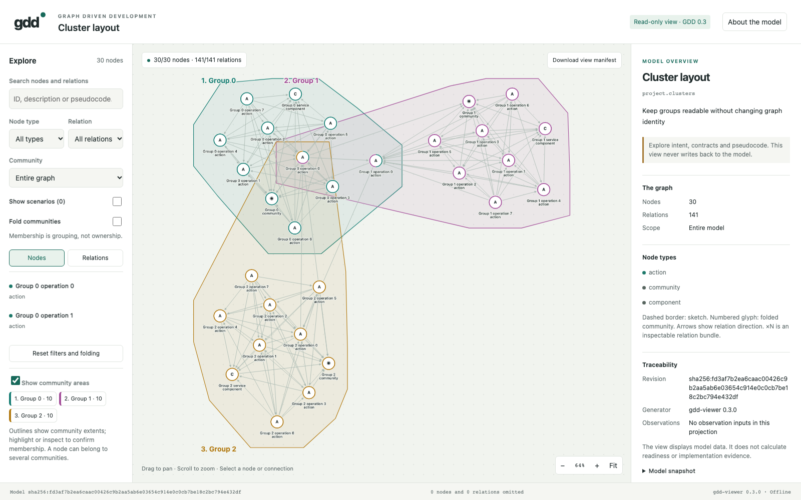
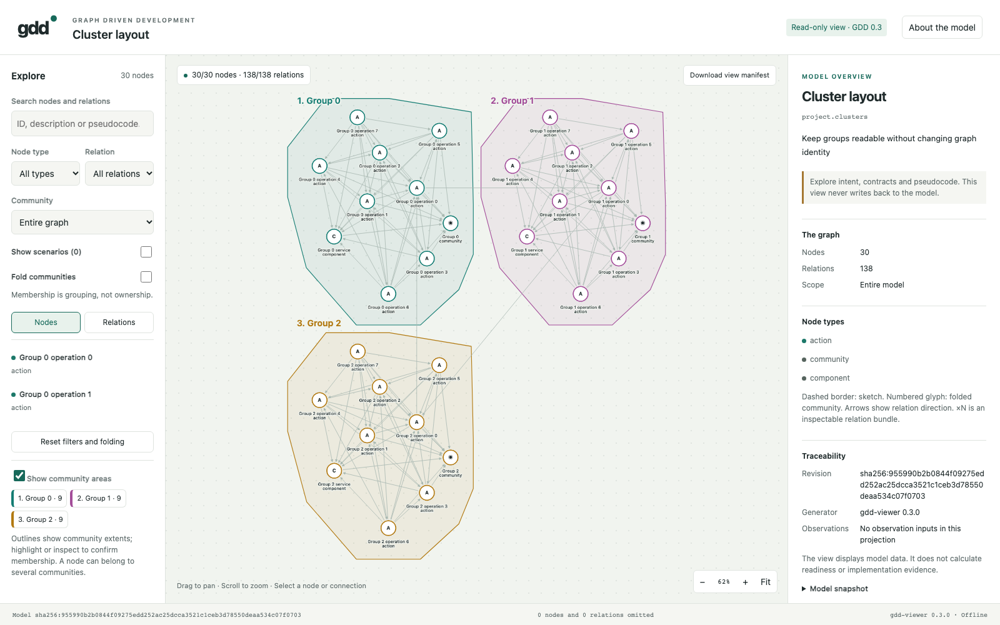
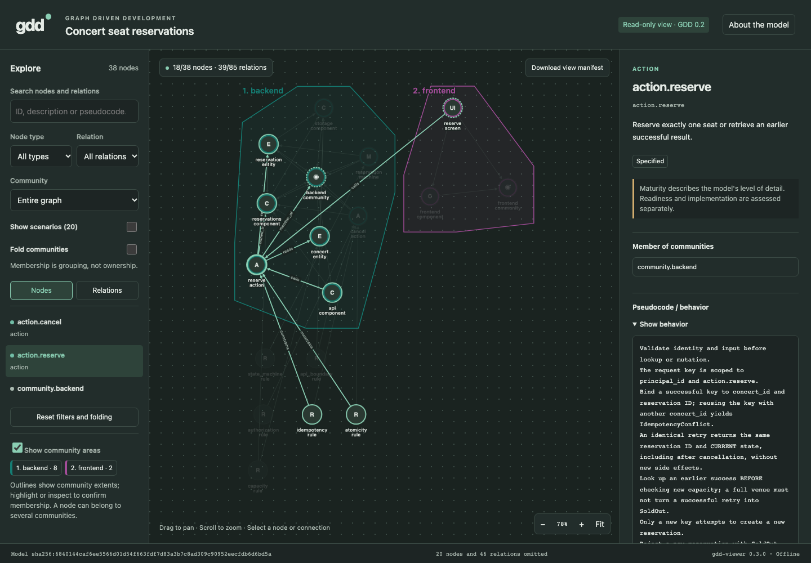
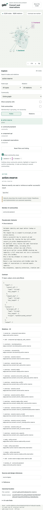

# Cytoscape viewer migration

Development package 0.8.0 uses viewer renderer 0.3.0. Cytoscape.js 3.34.4
renders the graph; fCoSE 2.2.0 lays out visual affinity regions, followed by
actual-caption separation and deterministic region packing. Explicit community
memberships remain independent of these placement hints.

Numbered headings, transparent overlapping extent envelopes, shared-node rings
and keyboard-accessible legend buttons make communities visible. A shared node
appears once. An envelope can enclose nonmembers: the legend and inspector use
explicit membership relations to identify exact members. Filtering, folding,
dragging, panning and zooming retain these semantics.

## Verification

The [verification record](verification.json) identifies actual tested source
bytes, graph payload comparisons, current derived artifacts and local checks.
[Browser results](browser-conformance.json) retain the final integrated run:
32/32 cases passed in Chromium 156.0.8078.4, with networking disabled, zero
script/console errors and zero external or sibling-asset requests. Checks cover
real canvas selection and dragging, directed parallel edges and self-loops,
keyboard inspection, exact manifests, stable filtering/reloads, caption and
heading collisions, responsive panels, overlapping membership and a bounded
300-node / 1,173-relation graph.

The full concert graph additionally checks that the community legend leaves the
canvas and footer within 1280 × 720 and 1440 × 600 desktop windows. Short
explorer panels scroll; their controls remain reachable.

The [installed-wheel results](installed-wheel.json) cover a fresh environment
outside the checkout, including bundled engine code, licenses and generated
offline views. The locked vendor build is reproducible; its VM smoke test runs
without network globals or dynamic code generation. No GitHub CI is configured.

All three current example HTML files were regenerated with this renderer and
verified exactly. Their canonical payloads and semantic manifests match the
pre-migration Git state except for generator identity. No standard or model
revision changed; the published v0.7.0 tag and older execution claims remain
tied to their original bytes.

## Fresh captures

These are new migration-review captures, separate from the original concert
application experiment. The fixtures are generated by the retained browser
harness; the record identifies the renderer and source hashes.

The 300-node case establishes bounded functional coverage, not a universal
performance guarantee. Dense graphs can still have crossing edges. Scope,
filters, folding and zoom remain useful for inspecting a readable subset.
