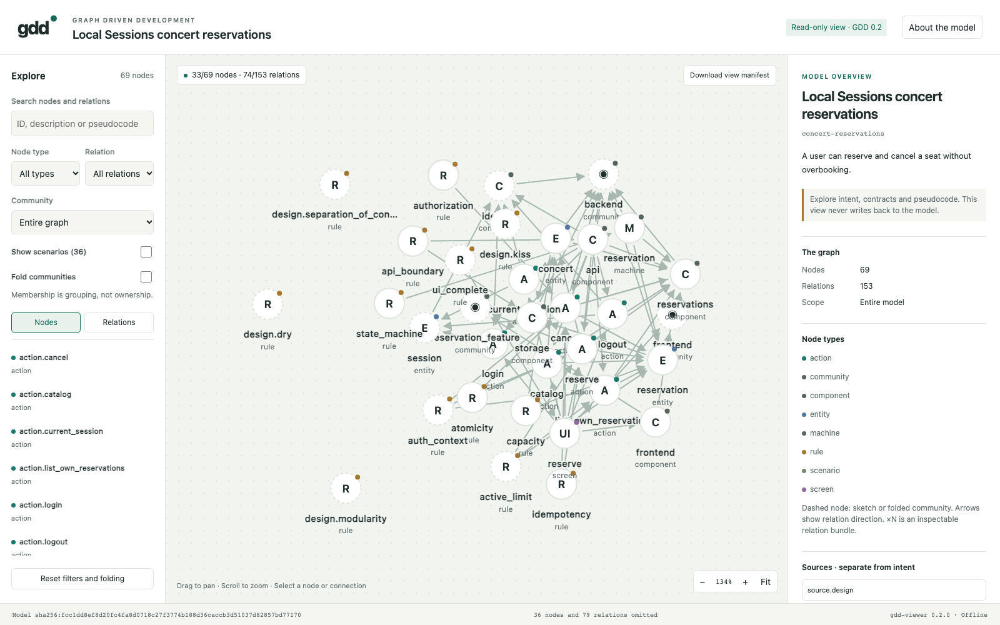
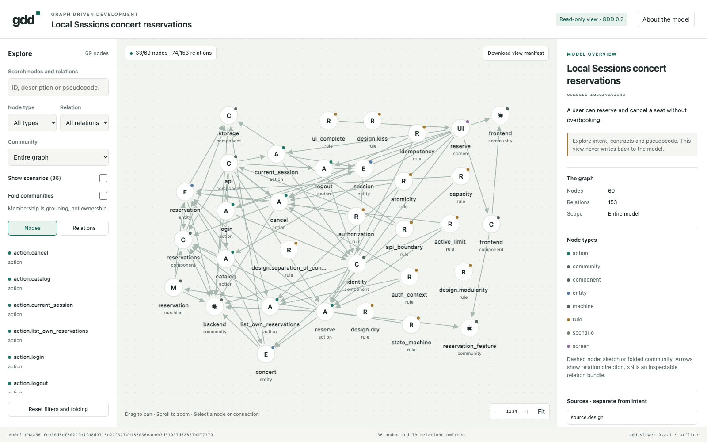

# Community-aware layout review

Development package 0.7.1 uses viewer renderer 0.2.1. This review checks the
layout change against Git base `b28cb0bdf2f2a76ff2a5648e6ca056b95907b26e`.
The published `v0.7.0` tag and its release assets remain unchanged.

The bounded force solver combines node repulsion, community attraction and
weaker springs between groups. It reserves space for glyphs and labels.
Unique component ownership supplies a position hint when membership is absent.
Hints never change model ownership, membership or graph projection.

## Observed results

- 39 focused visualization and portable-skill Python tests passed.
- All 16 visualization conformance cases matched their expected outcomes.
- All 27 Chromium browser cases passed offline, including dense community and
  ownership clusters, non-overlapping labels, repeatable reloads and stable filters.
- The wheel installed outside the checkout passed 20 CLI checks, legacy replay
  and comparison of 91 exact assets.
- All three regenerated current example views passed exact artifact verification.
  The downloaded browser view manifest passed its informative schema.

The [verification record](verification.json) identifies tested source bytes and
current artifact reports. [Browser results](browser-conformance.json) and
[installed-wheel results](installed-wheel.json) retain their actual run output.
These checks concern this renderer and the recorded working-tree bytes; they
do not establish application behavior or certify architectural quality.

## Same concert model, different placement

Both captures use Chromium 156.0.8078.4 at 1600 × 1000 with the default filters:
33 of 69 nodes and 74 of 153 relations. The earlier renderer was captured from
the Git base; the new renderer was captured from the current derived graph.
Both are fresh layout-review captures, separate from the original concert
application experiment's browser evidence.

The embedded canonical payload is identical except for generator identity.
The semantic view manifests are identical except for generator identity.
Measured intersections between different nodes' glyph/title rectangles decreased
from 20 pairs to zero. Raw rectangles and manifests are retained in
[before](concert-before.bounds.json) and [after](concert-after.bounds.json).
This measure excludes edges and kind subtitles; the dense browser fixtures
separately check glyphs and both text lines.

Before:

After:

The force solver is bounded to 200 visible figures. Larger projections use group
seeds without collision resolution. Scope, filtering, folding and zoom remain
useful for large or densely connected graphs; edge crossings are still possible.
